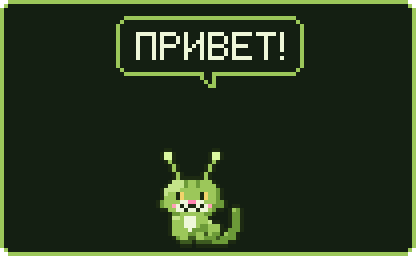
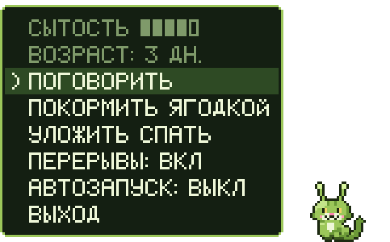

<p align="center">
  
</p>

<p align="center">
  <b>A pixel-art alien cat that lives above your Dock and talks through a tiny GPT written from scratch.</b><br>
  Pure Go · no cgo · fully offline · the whole brain is 225 KB
</p>

<p align="center">
  
  
  
  
</p>

<p align="center">
  
</p>

> **Mansur speaks Russian.** His menu, speech bubbles and training dialogs are in Russian. English is on the roadmap.

---

## Install

| | How | Best for |
|---|---|---|
| 🍎 **App** | Download `Mansur.dmg` from [Releases](https://github.com/artemnee/mansur/releases) | everyone |
| 🐹 **Go** | `go install github.com/artemnee/mansur@latest` | developers |
| 📦 **Binary** | one `curl` line, see below | terminal fans |

<details>
<summary><b>🍎 App (.dmg)</b></summary>

1. Download `Mansur.dmg` from the [latest release](https://github.com/artemnee/mansur/releases/latest).
2. Open it and drag **Mansur** into **Applications**.
3. On the first launch macOS will say it cannot verify the developer: the app is not signed with a paid Apple certificate. Open **System Settings → Privacy & Security** and click **Open Anyway**. You only do this once.

</details>

<details>
<summary><b>🐹 Go</b></summary>

Requires [Go](https://go.dev/dl/) 1.27+. No Xcode, no cgo.

```sh
go install github.com/artemnee/mansur@latest
mansur
```

Builds from source on your machine, so macOS shows no warning.

</details>

<details>
<summary><b>📦 Binary</b></summary>

```sh
# Apple Silicon
curl -L https://github.com/artemnee/mansur/releases/latest/download/mansur-darwin-arm64.tar.gz | tar xz
# Intel
curl -L https://github.com/artemnee/mansur/releases/latest/download/mansur-darwin-amd64.tar.gz | tar xz

./mansur
```

</details>

## Usage

```sh
mansur                 # move in (runs in the background, the terminal stays free)
mansur stop            # say goodbye
mansur status          # is he home?
mansur autostart on    # start at login (off: mansur autostart off)
mansur -size 6         # a bigger cat (default 4)
```

## What he does

<p align="center">
  
</p>

| You | Mansur |
|---|---|
| move the cursor over him | purrs, hearts fly |
| click | jumps |
| drag | dangles; let go and he lands on a window or the Dock |
| right click | opens his menu |
| nothing at all | strolls around his corner, follows your cursor, hops onto nearby windows, gets hungry |
| work 50 minutes without a pause | reminds you to take a break |
| stay up late | yawns and tells you to go to bed |

<table>
  <tr>
    <td align="center"><br><sub>His menu</sub></td>
    <td align="center"><br><sub>Talk to him; he remembers the last exchange</sub></td>
  </tr>
</table>

## The brain

Mansur's replies come from his own **decoder-only transformer** (the GPT-2 design), written from scratch in Go: forward pass, backpropagation, AdamW, int8 export and sampling. No ML libraries, no API, no internet.

| | |
|---|---|
| Architecture | 4 layers · 4 attention heads · width 64 · context 128 characters |
| Parameters | ~215K |
| Weights | int8 in groups of 64, **~225 KB**, embedded in the binary |
| Tokens | characters |
| Memory | the previous exchange: "what day is it" → "and tomorrow?" |
| Knowledge | writes `{время}`-style templates; the app fills in the real time, date, weekday, satiety and age |
| Honesty | if the network is unsure, Mansur says he doesn't know instead of babbling |

It learns from [`brain/dialogs.txt`](brain/dialogs.txt): human → Mansur pairs that depend on his mood (fine, hungry, sleepy). The trainer multiplies them with typos, colloquial forms and past-exchange memory.

```sh
go test ./brain                  # includes a numeric gradient check of the transformer
go run ./cmd/train -epochs 60    # retrain from scratch (~30 min on a laptop CPU)
make build                       # the new weights are embedded at build time
```

The network only knows the topics in `dialogs.txt`. Add a block there and retrain to teach it something new.

## Security

Mansur is a desktop toy, so he asks for nothing and touches very little.

- **No network.** There are no network calls in the code.
- **No screen reading.** To climb windows he reads only their positions (`CGWindowListCopyWindowInfo`), never their contents or titles, so no Screen Recording permission is needed.
- **No keyboard monitoring.** He receives key presses only while his own input box is open.
- **No clipboard access**, except ⌘V in his input box.

Files he writes, readable only by your user:

| File | Contents |
|---|---|
| `~/Library/Application Support/mansur/state.json` | satiety, settings, birthday |
| `~/Library/Caches/mansur/mansur.pid` | process id for `mansur stop` |
| `~/Library/LaunchAgents/com.artemnee.mansur.plist` | only when autostart is on |

**Verify a download.** Releases are built by GitHub Actions straight from a tagged commit ([`release.yml`](.github/workflows/release.yml)), and each file carries a build provenance attestation:

```sh
gh attestation verify Mansur.dmg --repo artemnee/mansur   # built by this repository
shasum -a 256 -c SHA256SUMS                              # not corrupted
```

`brain/weights.bin` is data, not code: int8 numbers read by the ~100-line loader in [`brain/io.go`](brain/io.go). You can regenerate it yourself with `go run ./cmd/train`.

## Building from source

```sh
make build   # bin/mansur
make run     # run in the foreground
make dmg     # dist/Mansur.dmg, universal (Apple Silicon + Intel)
MANSUR_ASSETS=docs go test -run TestReadmeAssets .   # re-render the images in this README
```

## Roadmap

- A smarter brain: a template data generator with hundreds of thousands of examples, a held-out test set, width 96.
- English: replies in the language you write in, UI in your system language.

## License

[MIT](LICENSE) © artemnee
