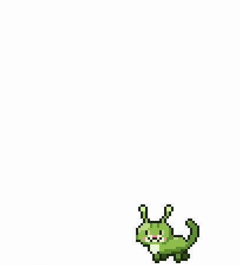
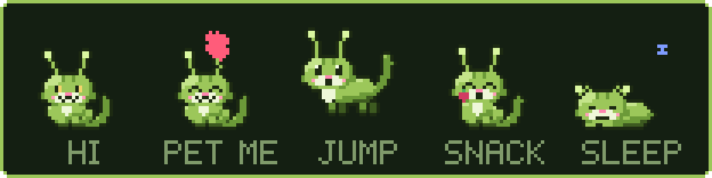
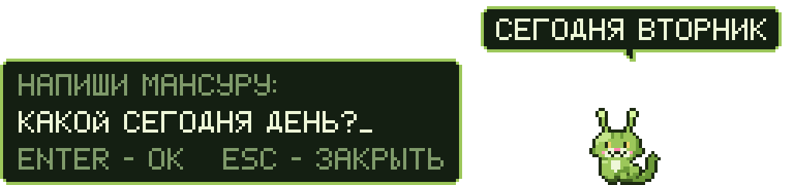

<p align="center">
  
</p>

<p align="center">
  <b>A pixel-art alien cat that lives above your Dock and chats in English and Russian<br>
  through his own tiny GPT, written and trained from scratch.</b><br>
  Runs locally · no API, no account · the whole brain is 490 KB
</p>

<p align="center">
  <a href="https://github.com/artemnee/mansur/releases/latest"></a>
  <a href="https://go.dev/dl/"></a>
  <a href="#the-brain"></a>
  <a href="LICENSE"></a>
</p>

<p align="center">
  
</p>

<p align="center">
  <br>
  <sub>On a real desktop</sub>
</p>

## Install

<p align="center">
  <a href="https://github.com/artemnee/mansur/releases/latest/download/Mansur.dmg"></a>
</p>

Or from the terminal:

```sh
curl -fsSL https://raw.githubusercontent.com/artemnee/mansur/main/install.sh | sh
```

Picks the build for your Mac, **verifies the checksum** and installs `mansur` to `~/.local/bin`. No `sudo`, no changes to your shell config. [Read the script](install.sh) first if you like.

Releases are built by [GitHub Actions](.github/workflows/release.yml) from a tagged commit and ship with `SHA256SUMS`.

<details>
<summary>Other ways: app, Go, manual download</summary>

**App:** open the downloaded `Mansur.dmg` and drag Mansur into Applications. The app is not signed with a paid Apple certificate, so on first launch open **System Settings → Privacy & Security → Open Anyway** once.

**Go 1.27+:** `go install github.com/artemnee/mansur@latest` (no Xcode, no cgo).

**Manual:** download `mansur-darwin-arm64.tar.gz` (Apple Silicon) or `mansur-darwin-amd64.tar.gz` (Intel) from Releases, check it with `shasum -a 256 -c SHA256SUMS`, unpack and move `mansur` into your `PATH`.

**Uninstall:** run `mansur autostart off && mansur stop` (or quit him from the menu), then delete `Mansur.app` from Applications or `~/.local/bin/mansur`. His state lives in `~/Library/Application Support/mansur`.

</details>

**Update:** install the same way again and restart him; his state is kept. Turn on **updates** in his menu to be told when a new version is out.

## Use

```sh
mansur                 # move in (runs in the background)
mansur stop            # say goodbye
mansur status
mansur autostart on    # start at login
mansur -size 6         # a bigger cat
```

| You | Mansur |
|---|---|
| hover over him | purrs, hearts fly |
| click | jumps |
| drag | dangles, then lands on a window or the Dock |
| right click | menu: talk, feed, sleep, break reminders, autostart, language, updates |
| leave him be | strolls around his corner, follows the cursor, hops onto nearby windows, yawns, stretches, grooms, gets hungry |
| dart the cursor around him | hunts it and pounces |
| work 50 min straight | reminds you to take a break |
| tell him "my name is …" | remembers it and greets you by name |
| come back after a while | "you're back!", or "I missed you" after a few days |
| ignore him for hours | sulks, turns away and grumbles until you pet him |

**His character grows from how you treat him:** pet him a lot and he gets cuddly and comes to your cursor; feed him often and he gets greedy; talk to him and he gets chatty; leave him alone and he becomes independent. The menu shows what he has become.

<p align="center">
  
</p>

<table>
  <tr>
    <td align="center"><br><sub>His menu</sub></td>
    <td align="center"><br><sub>He replies in the language you write in</sub></td>
  </tr>
</table>

## The brain

A decoder-only transformer (the GPT-2 design) written from scratch in Go. It runs inside the app on the CPU and answers in a fraction of a second.

| | |
|---|---|
| Size | 4 layers, 4 heads, width 96, 128-character context, ~470K parameters, **490 KB** in int8 |
| Languages | English and Russian; replies in the language of your message |
| Knows | ~120 small-talk topics, his own moods, simple facts, adding numbers up to 10, the time and date |
| Memory | the previous exchange: "what day is it?" → "and tomorrow?" |
| Honesty | says "I don't know" when unsure |
| Quality | 89% on 159 held-out questions, 100% in the right language ([`eval_test.go`](brain/eval_test.go)) |

The network writes templates like `{time_en}`, and the app fills in the real time, date and weekday, so those answers are always correct.

**Training data:** [`brain/dialogs.txt`](brain/dialogs.txt) (Russian) and [`brain/dialogs_en.txt`](brain/dialogs_en.txt) (English), expanded with paraphrases, typos and language switches by [`cmd/train`](cmd/train).

## Privacy

- No telemetry. The only network request is the optional update check ([`update.go`](update.go)), off until you turn it on.
- Reads only window positions, never their contents or titles, and no keystrokes outside his own chat box.
- Everything he remembers about you stays in `~/Library/Application Support/mansur`, readable only by you.

## Development

```sh
make build   # bin/mansur
make run     # run in the foreground
make dmg     # dist/Mansur.dmg (Apple Silicon + Intel)
go test ./...
MANSUR_ASSETS=docs go test -run TestReadmeAssets .   # re-render the README images
```

Retraining the brain runs on the Mac GPU with PyTorch (~25 s per epoch); the app itself is pure Go.

```sh
go run ./cmd/train -dump training/data               # export tokenized samples
uv venv training/.venv && uv pip install --python training/.venv/bin/python -r training/requirements.txt
training/.venv/bin/python training/train.py           # writes training/out/weights.bin
cp training/out/weights.bin brain/ && go test -v ./brain # quality report
```

## License

[MIT](LICENSE) © artemnee
